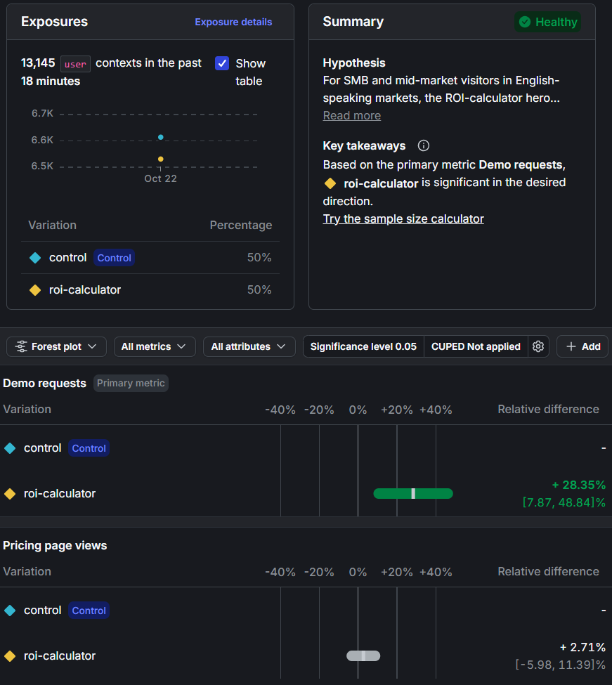

# ABC Pulse: a LaunchDarkly sample app

ABC Company sells **Pulse**, a customer-success platform for B2B SaaS companies. Customer
success managers (CSMs) use it to track account health, product adoption, and renewal risk.

ABC's competitors are catching up, and leadership wants features shipped faster. ABC's
enterprise customers expect high quality, so shipping faster can't mean shipping riskier.
This sample app shows how LaunchDarkly helps ABC meet both goals. Teams can **test in
production, release gradually, roll back instantly, target precisely, measure impact, and
manage AI behavior at runtime**, all without redeploying.

> **Status:** work in progress. Sections marked _Coming in Phase N_ are being built.

---

## 1. What this demonstrates

| Surface | URL | Scenario |
|---|---|---|
| Marketing site (about 40k visitors/day in the story) | `http://localhost:5000/` | **Target**: individual and rule-based targeting of a new landing-page hero · **Experimentation**: does the new hero increase demo requests? |
| Pulse app (signed-in CSMs) | `http://localhost:5000/app` | **Release & Remediate**: a new Account Health panel behind a flag, live toggling, and a trigger-based kill switch · **AI Configs**: an account-summary assistant whose model and prompt change by role |

_Detailed business framing for each part: Coming in Phase 7._

---

## 2. Prerequisites & assumptions

- **OS:** Windows 10/11, macOS, or Linux. Commands are given for PowerShell (Windows) and bash/zsh (macOS/Linux).
- **Python 3.11 or newer** on your `PATH`. Check with `python --version` (on some macOS/Linux systems, `python3 --version`).
- **git**, to clone the repo.
- A modern browser (Chrome, Edge, Firefox, or Safari).
- **A LaunchDarkly account.** A [free trial](https://launchdarkly.com/start-trial/) works. You don't need it for the first run below. It's required from the LaunchDarkly setup step onward.
- _Optional:_ an **Anthropic** API key for the AI assistant. Without one, the app uses a built-in mock.
- Port **5000** must be free (see [Troubleshooting](#6-troubleshooting)).

---

## 3. LaunchDarkly setup

The app runs without LaunchDarkly: every flag then serves its **fallback value** (the
existing, safe experience). Connect it to see flags, targeting, and live updates.

### 3.0 Automated setup (recommended)

[scripts/setup_launchdarkly.py](scripts/setup_launchdarkly.py) builds everything below through
LaunchDarkly's REST API, in about a minute:
- the project, if it doesn't exist yet;
- the three flags, with their variations and the demo targeting;
- the kill-switch trigger;
- both experiment metrics;
- the AI Config.

It then writes the SDK key, client-side ID and trigger URL into `.env` (it only fills **blank**
values) and checks that every persona gets the expected result.

1. In LaunchDarkly, create an **API access token**: **Organization settings → Authorization →
   Create token**, with the **Writer** role (**Admin** if the script needs to create the project).
   Put it in `.env` as `LD_API_TOKEN`. It's a secret, and `.env` is gitignored.
2. Run it with the venv active, from the repo root:
   ```bash
   python scripts/setup_launchdarkly.py               # uses LD_PROJECT_KEY / LD_ENVIRONMENT_KEY from .env
   python scripts/setup_launchdarkly.py --dry-run     # optional: preview without changing anything
   ```
   A successful run ends with `[ok]` for every check.
3. Create and **start** the experiment in the UI (the last table in section 3.2). It's the one
   step that isn't automated: starting an experiment is a deliberate product decision.
4. Restart `python app.py`.

**Safe to re-run.** Anything that already exists is left alone, so running it against a project
you set up by hand changes nothing. `--reset` puts the flags' and AI Config's **targeting** back to
the documented demo state, for example after experimenting in the demo. Flag triggers and AI
Configs depend on your LaunchDarkly plan; if one isn't available, the script says so and carries on.

**The manual steps below are the reference for what the script creates, and the fallback if you'd
rather click through it.**

### 3.1 Connect the SDKs

1. Sign in to LaunchDarkly (a [trial account](https://launchdarkly.com/start-trial/) works).
2. Create a project, e.g. **ABC Pulse** (key `abc-pulse`). It comes with **Test** and
   **Production** environments. Use **Test** for this demo.
3. Open **Project settings → Environments → Test**, then copy two values into your `.env`
   (see step 4.3):

   | `.env` variable | LaunchDarkly value | Used by | Secret? |
   |---|---|---|---|
   | `LD_SDK_KEY` | **SDK key** (starts with `sdk-`) | Python server SDK ([ld.py](ld.py)) | **Yes**: never put it in browser code |
   | `LD_CLIENT_SIDE_ID` | **Client-side ID** | JavaScript SDK in the browser ([static/js/ld.js](static/js/ld.js)) | No: designed to be public |

4. Restart `python app.py`. The **Demo controls** panel (bottom-right) should show both
   SDKs as **Connected**.

### 3.2 Flags

Create these flags in your project (**Flags → Create flag**) with **exactly** these keys, or let
the setup script (section 3.0) do it.

> **Client-side availability matters.** Anything the browser can read, anyone with your
> (public) client-side ID can read. So expose a flag to client-side SDKs only if the browser
> needs it, and never check **SDKs using Mobile key** here: there's no mobile app.

#### `account-health-panel`: the new Account Health experience (Part 1)

| Setting | Value |
|---|---|
| Name / key | Account health panel / `account-health-panel` |
| Type | Boolean: `true` (new panel), `false` (legacy usage stats) |
| Temporary or permanent | **Temporary.** It's a release flag; remove it once fully rolled out |
| Client-side availability | ✅ **SDKs using Client-side ID** (the browser renders it and listens for changes) |
| Variation served when off | `false` |
| Targeting rule 1 | **If** context kind `user`, attribute `betaTester` **is one of** `true` (boolean) → serve `true` |
| Default rule | `false` to start. Change it to `true` to release to everyone |

If `betaTester` isn't in the attribute dropdown yet, type it in. LaunchDarkly lists attributes
only after it has received contexts that use them.

#### `health-score-v2-calc`: the new (buggy) scoring algorithm (Part 1 remediation)

| Setting | Value |
|---|---|
| Name / key | Health score v2 calculation / `health-score-v2-calc` |
| Type | Boolean: `true` (v2 algorithm), `false` (v1) |
| Temporary or permanent | **Temporary** |
| Client-side availability | ☐ **Leave unchecked.** Evaluated only on the server ([app.py](app.py)) |
| Variation served when off | `false` |
| Targeting rule 1 | Same beta-tester rule as above → serve `true` |
| Default rule | `false` |

The demo panel still shows this flag's value. The browser reads it from `/api/server-flags`
(tagged `server`), polled every 3 seconds. In production you'd push it instead (SSE or
WebSocket). The client-side flag above uses the SDK's real streaming listener.

#### Flag trigger: the remediation kill switch

1. Open `health-score-v2-calc` and go to its **Triggers** settings, in the **Test** environment.
2. Add a trigger. Choose **Generic trigger** as the tool and **Turn the flag off** as the action.
3. Copy the generated URL into `.env` as `LD_TRIGGER_URL`. **LaunchDarkly shows it only once.**
   If you lose it, reset the URL from the trigger's menu. Treat it like a password: anyone with
   the URL can flip the flag.

> Flag triggers are only available on some LaunchDarkly plans; trials normally include them.
> Without triggers, you can still demo the same failure and recovery by turning the flag off
> in the dashboard. `watchdog.py --dry-run` still detects the error spike.

#### `landing-hero`: the marketing-site hero (Part 2)

| Setting | Value |
|---|---|
| Name / key | Landing hero / `landing-hero` |
| Type | **String**, with three variations whose **values** are exactly `control`, `roi-calculator`, `social-proof`. The names can be anything. LaunchDarkly pre-fills new string variations with placeholder values like "Variation 1"; replace them, or the page won't recognize the value and will show `control` |
| Temporary or permanent | **Temporary.** Roll out the winning variant, then remove the flag |
| Client-side availability | ✅ **SDKs using Client-side ID** (the browser renders the hero) |
| Variation served when off | `control` |

**Individual targeting:** serve `roi-calculator` to the `user` contexts `qa-tester-01` and
`sales-demo`. Individual targets are checked **before** any rule. That lets QA and Sales preview
the new hero even when their attributes would otherwise hold them on `control`.

**Rules: add them in this order.** LaunchDarkly serves the **first** rule that matches, so
restrictions come first. An opportunity rule (like rule 4) can then never override a compliance or
localization hold.

| # | If (context kind `user`) | Serve | Business reason |
|---|---|---|---|
| 1 | `country` **is one of** `DE`, `FR` | `control` | Localization isn't ready, so non-English markets keep the current page |
| 2 | `industry` **is one of** `Fintech`, `Healthcare` | `control` | The new copy makes ROI claims that compliance hasn't approved for regulated industries |
| 3 | `referrer` **is one of** `linkedin` | `social-proof` | Visitors from social channels respond best to peer validation |
| 4 | `companySize` **≥** `500` (number) | `roi-calculator` | Enterprise buyers need a business case for budget approval |
| Default | **Percentage rollout:** `roi-calculator` 10%, `control` 90% | | About 40,000 visitors a day: limit the blast radius while the new hero proves itself |

All attribute values are case-sensitive. Use `≥` ("greater than or equal") with the number
`500`, not text. The default rule's percentage rollout buckets by context key, so each visitor
always lands in the same bucket.

#### Experiment: ROI calculator vs control (extra credit)

**1. Create two metrics** (**Metrics → Create metric**, *LaunchDarkly hosted* if asked):

| Setting | Primary metric | Secondary (guardrail) metric |
|---|---|---|
| Event kind | Custom | Custom |
| Event key | `demo-request-clicked` | `pricing-page-viewed` |
| Metric definition | Occurrence (Percent) | Occurrence (Percent) |
| Analysis unit | `user` | `user` |
| Success criteria | Higher is better | Higher is better |
| Name | Demo requests | Pricing page views |

The browser sends these events with `track()` ([static/js/marketing.js](static/js/marketing.js)):
`demo-request-clicked` on every **Request a demo** button, and `pricing-page-viewed` on the
**Pricing** link. The simulator sends the same events from the server SDK.

**2. Add rule 5 to `landing-hero`**, after rule 4. This is the experiment's audience:

| # | If (context kind `user`) | Serve |
|---|---|---|
| 5 | `country` **is one of** `US`, `GB`, `CA`, `AU` | `control` for now (the experiment takes over this rule) |

LaunchDarkly recommends experimenting on a specific rule rather than the default rule. Because
rules 1–4 and the individual targets come first, the audience is **SMB and mid-market visitors
in English-speaking markets, in non-regulated industries, not from LinkedIn**. Enterprise buyers
(rule 4) already get the ROI calculator; the open question is whether it helps everyone else.

**3. Create the experiment** (**Create → Experiment**):

| Setting | Value |
|---|---|
| Name | Landing hero: ROI calculator vs control |
| Hypothesis | For SMB and mid-market visitors in English-speaking markets, the ROI-calculator hero increases demo requests compared with the current hero. |
| Assignment method | LaunchDarkly flag: `landing-hero` |
| Targeting rule | **Rule 5** (country is one of US, GB, CA, AU) |
| Randomize by | `user` |
| Audience allocation | 100% of the rule's contexts. Contexts outside the experiment are served `control` |
| Variations split | `control` 50%, `roi-calculator` 50%, `social-proof` 0%. **Control:** `control` |
| Metrics | `Demo requests` (**primary**), `Pricing page views` |
| Statistical approach | **Frequentist**, significance level 0.05 (the default; LaunchDarkly recommends it for 1,000+ contexts) |
| Attributes (Advanced) | Leave empty. Marketing visitors are **anonymous contexts**, and LaunchDarkly can't filter experiment results by anonymous contexts' attributes |

Save, make sure the flag is **on**, and click **Start** on the experiment for the **Test**
environment. Only events sent **after** the iteration starts are counted.

#### AI Config: `account-assistant` (extra credit)

LaunchDarkly's newer docs call AI Configs **AgentControl**; the UI may use either name. It's an
add-on, so if **Agents** isn't in the sidebar, your account may not include it.

1. **Agents → Configs → Create**, choose **Completion**, name it "Account assistant", and set the
   key to **`account-assistant`**. Keys can't be changed later.
2. On the **Variations** tab, click **Add variation** for each of the two below. Click
   **Select a model** to choose the model, **Add parameters** to set model and custom
   parameters, and **+ Add message** for the second message. Then **Review and save**.

| Setting | `exec-brief` | `csm-deep-dive` |
|---|---|---|
| Model provider / model | Anthropic / **`claude-haiku-5-5`** (fast, low cost) | Anthropic / **`claude-opus-5-5`** (most capable) |
| Model parameters (JSON) | `{"max_tokens": 4000}` | `{"max_tokens": 16000}` |
| Custom parameters (JSON) | `{"effort": "low", "style": "brief"}` | `{"effort": "medium", "style": "detailed"}` |
| System message | `You are a customer success analyst briefing an executive. Summarize this account's renewal risk in exactly 3 short bullets: outlook, biggest risk, and the one decision or ask for leadership. Plain language, no jargon.` | `You are a senior customer success analyst writing for the CSM who owns this account. Give a short health summary, the key risk drivers, and 3 to 5 recommended next actions, each with an owner and timing. Use "###" headings and "-" bullets.` |
| User message | `Account data:` followed by `{{account_json}}` on the next line | same |

- **Variables:** the app supplies `{{account_json}}` (the account's data) and `{{account_name}}`.
  LaunchDarkly also exposes the context as `{{ldctx}}`, e.g. `{{ldctx.user.name}}`.
- **Custom parameters:** `effort` controls how much the Claude model reasons (`low` is fast and
  cheap). `style` is used only by the **mock** provider, to pick a brief or detailed layout.
- **Don't add `temperature`.** Current Claude models reject sampling parameters, so the app
  ignores it (and logs that it did).
- If a model ID isn't in LaunchDarkly's model list, add it as a custom model using exactly that ID.

3. **Targeting:** turn the AI Config on, then add rule 1: context kind `user`, attribute `role`
**is one of** `Exec` → `exec-brief`. Set the **default rule** to `csm-deep-dive` (CSMs and
CS managers).

**Real model or mock:** with `LLM_API_KEY` set to an Anthropic API key in `.env`, the assistant
calls Claude. Without one, a mock writes the summary from the account data. The mock still
reads the variation (style, model name, system prompt), so every AI Config change is visible.

### 3.3 How the app talks to LaunchDarkly

- **Browser:** [static/js/ld.js](static/js/ld.js) starts the JavaScript SDK
  (`@launchdarkly/js-client-sdk` v4) with a **streaming** connection and a **change listener**.
  When a flag changes in LaunchDarkly, the page updates instantly, with no reload.
  The SDK is **self-hosted** under `static/vendor/`, copied unmodified from the npm package, as
  LaunchDarkly recommends for production instead of a public CDN.
- **Server:** [ld.py](ld.py) starts the Python server SDK once per process. All server-side
  evaluations go through `ld.evaluate()`, which applies the fallbacks from [flags.py](flags.py).
- **Contexts:** the "who" that flags are evaluated for. They're defined once in
  [personas.py](personas.py) and used by both the browser and the server:
  - **Marketing site:** a `user` context per visitor, with `industry`, `companySize`,
    `country`, `referrer`, and `device`. Anonymous visitors are marked `anonymous`.
  - **Pulse app:** a **multi-context** of `user` (`role`, `region`, `betaTester`, `email`)
    plus `organization` (the customer company: `plan`, `seats`). `email` is a **private
    attribute**: it can still be used in targeting rules, but its value is never sent to
    LaunchDarkly in analytics events.

### 3.4 The Demo controls panel

Both pages have a dark **Demo controls** card in the bottom-right corner. It is **not part of
the product**. It stands in for real visitors and logged-in users:

- **Persona:** switches the LaunchDarkly context with `identify()`, so targeting changes appear
  live. Choose **Random visitor**, then **↻ New random visitor**, to see percentage rollouts
  bucket different visitors.
- **Connection:** status of the browser and server SDKs. Hover over a status for details.
- **Flags (live):** the current value of each flag on this page, plus the **reason**
  LaunchDarkly gave for it (e.g. *Individual target*, *Rule 2*, *Default rule*, *Flag off*).
  A value flashes when it changes. Server-only flags are tagged `server`.

Click the panel's title to collapse it.

---

## 4. Run the app

### 4.1 Clone and create a virtual environment

**Windows (PowerShell)**
```powershell
git clone https://github.com/3dhedges/abc-pulse.git
cd abc-pulse
python -m venv .venv
.\.venv\Scripts\Activate.ps1
```
> If PowerShell blocks the activation script, run
> `Set-ExecutionPolicy -Scope CurrentUser RemoteSigned` once, then try again.

**macOS / Linux**
```bash
git clone https://github.com/3dhedges/abc-pulse.git
cd abc-pulse
python3 -m venv .venv
source .venv/bin/activate
```

### 4.2 Install dependencies
With the virtual environment active:
```bash
python -m pip install -r requirements.txt
```
`python -m pip` guarantees pip installs into the same Python you run the app with. A bare `pip`
can belong to a different Python install on machines that have several.

### 4.3 Create your `.env`
**Windows:** `Copy-Item .env.example .env`  ·  **macOS/Linux:** `cp .env.example .env`

You can leave every value blank for now. The app runs without LaunchDarkly keys and shows
its default (flag-off) experience.

### 4.4 (Optional) Regenerate the sample data
`data/accounts.json` ships with the repo. To regenerate it:
```bash
python scripts/seed_data.py
```
The script uses a fixed random seed, so it always produces the same 50 fictional accounts.

### 4.5 Start the server
```bash
python app.py
```
Open:
- **http://localhost:5000/**: marketing site
- **http://localhost:5000/app**: Pulse app

Stop the server with `Ctrl+C`.

---

## 5. Demo script

Each part is a "do X, watch Y" walkthrough. Keep the LaunchDarkly dashboard and the app side by
side, with the **Demo controls** panel open.

> Some steps run a script while the server keeps running. Open a **second terminal** in the
> repo folder and **activate the virtual environment there too** (step 4.1) before running
> `scripts/*.py`.

### 5.1 Release & Remediate (Part 1): `/app`

**Scenario:** ABC wants to ship a new Account Health experience faster without risking quality.
The plan: test it in production with internal beta testers, release it to everyone, and
make sure any bad change can be turned off in seconds.

**Before you start:** both flags exist with the beta-tester rule and default `false`.
`account-health-panel` is **on**, `health-score-v2-calc` is **off** (step 5 turns it on), and the
trigger URL is in `.env` (section 3.2). The setup script leaves things in exactly this state.

| # | Do | Watch |
|---|---|---|
| 1 | Pick **Marco Rossi** (no beta) in the demo panel | Legacy **usage-stats table**: the existing experience |
| 2 | Switch to **Dana Whitfield** (beta tester) | Instantly: a **Health** column and the new **Account health** panel. **Testing in production:** only beta testers see it |
| 3 | In LaunchDarkly, set `account-health-panel`'s default rule to `true` and save. Switch to Marco | Marco now has the new panel too, with no reload. **Released** to everyone |
| 4 | Toggle `account-health-panel` **off** | Every open session snaps back to the legacy table within a second. **Instant rollback** with no deploy |
| 5 | Toggle it back **on**. Turn on `health-score-v2-calc`, as Dana | Within about 3 seconds, the panel says **Scoring v2**, and 5 accounts show **Error** (HTTP 500). Sort the **Health** column to bring them to the top. **The bug is real:** v2 divides by open tickets, which is zero for some accounts |
| 6 | **Remediate manually:** run `./scripts/kill-switch.sh` (Git Bash/macOS/Linux) or `Invoke-RestMethod -Method Post -Uri <LD_TRIGGER_URL>` (PowerShell) | The trigger turns v2 **off**. Within about 3 seconds the errors clear and **Scoring v1** returns. The panel stays: only the bad change was removed. The flag's **History** in LaunchDarkly shows the trigger and its message |
| 7 | **Remediate automatically:** turn v2 back on, then run `python scripts/watchdog.py` in a second terminal. Reload `/app` as Dana, or click a few accounts | The watchdog prints the error rate every 5 seconds. Once it passes **5%** (with at least 20 requests in the last minute) it fires the trigger and exits, and the app recovers on its own |

**What the watchdog stands in for:** in production this is a Datadog or New Relic alert whose
webhook calls the LaunchDarkly trigger URL. Nobody has to be awake for the rollback.
`python scripts/watchdog.py --help` lists the threshold, minimum-request, and interval options.
`--dry-run` reports a breach without firing.

### 5.2 Target (Part 2): `/`

**Scenario:** several teams are revamping the landing page, which gets about 40,000 visitors a day.
This team owns the **hero**. They want to show each audience the hero that fits them, keep
restricted audiences on the current page, and limit everyone else's exposure.

**Before you start:** `landing-hero` is set up as in section 3.2, and the flag is **on**.

Under **Flags (live)**, the demo panel shows each flag's value **and the reason** LaunchDarkly
returned for it (*Individual target*, *Rule N*, *Default rule*). That makes every targeting
decision visible.

| # | Do: pick persona | Watch: hero | Panel reason | Why |
|---|---|---|---|---|
| 1 | **Enterprise SaaS visitor** (US · SaaS · 2,000 employees) | ROI calculator | Rule 4 | Enterprise buyer, no restrictions |
| 2 | **Mid-market fintech visitor** (US · Fintech · from LinkedIn) | Control | Rule 2 | Matches rule 2 *and* rule 3. The first match wins, so compliance beats channel |
| 3 | **German startup visitor** (DE) | Control | Rule 1 | Localization hold |
| 4 | **LinkedIn visitor** (US · Retail) | Social proof | Rule 3 | Social-channel audience |
| 5 | **QA tester** (`qa-tester-01`, based in DE) | ROI calculator | Individual target | Individual targeting beats the DE rule, so QA can test the new hero |
| 6 | **Sales demo** (`sales-demo`, Fintech) | ROI calculator | Individual target | Sales can demo it despite the compliance hold |
| 7 | **Random visitor**, then click **↻ New random visitor** several times | Varies | Usually **Rule 5 · in experiment** once the experiment is running (section 5.3), otherwise whichever rule matches. The default rule's 10% rollout applies to countries no rule covers | Random visitors are randomized 50/50 into the experiment. A visitor keeps its variation across reloads |

**Live targeting change:** with the **German startup visitor** selected, remove `DE` from rule 1
in LaunchDarkly and save. Without a reload, the hero changes as the visitor falls through to the
default rollout.

Try the ROI calculator's inputs too: the results update as you type.

### 5.3 Experimentation (extra credit): `/`

**Scenario:** as the PM, you need evidence before making the ROI-calculator hero the default
for everyone. The experiment runs on rule 5's audience (section 3.2) and measures demo requests
(primary) and pricing page views (guardrail).

> **The traffic is simulated.** A demo site has no real visitors, so
> [scripts/simulate_traffic.py](scripts/simulate_traffic.py) sends simulated visitors through
> the **real** Python SDK. LaunchDarkly evaluates the flag and randomizes each visitor exactly as
> for a real page view, and conversions are sent with `track()`. The simulator's "true"
> conversion rates are in the `RATES` table at the top of the script. The experiment's job is
> to recover them from the data. Real clicks on the page are counted too.

| # | Do | Watch |
|---|---|---|
| 1 | Set up both metrics, rule 5 and the experiment, and **start** the iteration (section 3.2) | The experiment shows as running |
| 2 | On `/`, choose **Random visitor** and click **↻ New random visitor** until the panel says **Rule 5 · in experiment**. Click **Request a demo** | The event appears in the metric's recent events (and in **Live events**) after a short delay |
| 3 | Run `python scripts/simulate_traffic.py` (about 2 minutes) | Progress every 500 visitors, then a summary: visitors per variation, how many were **in the experiment**, and the simulator's own conversion rates (overall and desktop / mobile) |
| 4 | Open the experiment's **Results** after a few minutes | Exposures and conversions per variation, the lift, and whether the result is statistically significant |

`python scripts/simulate_traffic.py --dry-run` previews the math without sending anything.
`--visitors` and `--rate` change the size and speed. Each run uses fresh visitors, so running it
again adds to the sample.

#### Results & decision



**Decision memo: Landing hero, ROI calculator vs control**

| | |
|---|---|
| **Audience** | Rule 5: SMB and mid-market visitors in US/GB/CA/AU, non-regulated industries, not from LinkedIn |
| **Sample** | 13,145 `user` contexts, split 50/50 (about 6.6k per arm). About two-thirds of the 20,000 simulated visitors; the rest matched rules 1–4 and were correctly kept out |
| **Primary: Demo requests** | **+28.35%** relative lift for `roi-calculator`, 95% CI **[+7.87%, +48.84%]**. **Statistically significant** at α = 0.05 (frequentist) |
| **Guardrail: Pricing page views** | +2.71%, 95% CI [−5.98%, +11.39%]. **No significant change**: the calculator doesn't pull attention away from pricing |

**Decision: ship the ROI calculator to this audience.** Stop the experiment and serve
`roi-calculator` on rule 5 (LaunchDarkly can ship the winning variation directly from the
experiment). Keep `control` in the codebase until the flag is retired.

**Why it's safe to act on:**
- The whole confidence interval is above zero. Even the pessimistic end (+7.9%) is a
  meaningful gain in demo requests.
- The guardrail didn't move, so there's no hidden cost.
- The rollout is a flag change, not a deploy, so it can be reversed instantly if real-world
  numbers disagree.

**Caveats and next steps:**
- **Plan on the low end of the interval.** It's wide (+8% to +49%). Use +8–10%, not +28%, for
  pipeline forecasts.
- **Run longer with real traffic.** This sample was collected in 18 minutes of simulated
  traffic. A real test should cover at least one or two full weeks to account for weekday and
  weekend patterns, even if it reaches significance sooner.
- **Expand the audience next.** Rules 1 and 2 hold DE/FR (localization) and regulated
  industries (compliance review of the ROI claims) on `control`. Once those are cleared, the
  same flag can extend the calculator to them, ideally as a new experiment.

> Results come from **simulated** traffic. The simulator's true lift was about +34%
> (3.97% → 5.31%). LaunchDarkly measured +28% from the data, well within its confidence interval.
### 5.4 AI Configs (extra credit): `/app`

**Scenario:** ABC is rolling out an AI assistant that summarizes customer accounts. As the AI
PM, you want each audience to get the right model and prompt (executives need a fast, short
brief; CSMs need a thorough review), and you want to improve prompts **without waiting for a
deploy**. LaunchDarkly measures cost, speed, and user satisfaction per variation.

**Before you start:** `account-assistant` is set up as in section 3.2. `LLM_API_KEY` is optional.

| # | Do | Watch |
|---|---|---|
| 1 | As **Priya Raman** (Exec), select an account and click **Summarize this account** | Three bullets. The meta line shows `exec-brief · claude-haiku-5-5 · …s · … tokens` |
| 2 | Switch to **Dana Whitfield** (CSM) and summarize again | A detailed review with headings and next actions: `csm-deep-dive · claude-opus-5-5`. It's slower and uses more tokens, the expected trade-off |
| 3 | In LaunchDarkly, edit `csm-deep-dive`'s system message (e.g. "…and end with a one-line risk rating") and save. Summarize again as Dana | The new prompt applies immediately, with no deploy or restart. In mock mode, the footer quotes the new first line |
| 4 | Change the `Exec` rule to serve `csm-deep-dive`. Summarize as Priya | Priya now gets the deep dive. Change it back |
| 5 | Click 👍 or 👎 on a few summaries | "Thanks for the feedback." |
| 6 | Open the AI Config's **Monitoring** tab | Generations, tokens, duration, success rate, and positive/negative feedback, per variation |
| 7 | Turn the AI Config **off** in LaunchDarkly and summarize again | "The account assistant is turned off": an instant kill switch for the AI feature |

With LaunchDarkly unreachable, the assistant uses a built-in fallback configuration (a short
Haiku brief), so it keeps working. The meta line then shows the variation as `fallback`.

---

## 6. Troubleshooting

| Symptom | Fix |
|---|---|
| `Address already in use` or nothing loads on port 5000 (common on macOS, where AirPlay Receiver uses 5000) | Set `PORT=5050` in `.env`, restart, and open `http://localhost:5050`. |
| `Missing .../data/accounts.json` on startup | Run `python scripts/seed_data.py`. |
| `ModuleNotFoundError: No module named 'flask'` (or `'ldclient'`, `'dotenv'`) | The virtual environment isn't active in **this** terminal. Activate it (step 4.1) in every new terminal, including the second one used for `watchdog.py` or `simulate_traffic.py`. Or run `.venv\Scripts\python` (Windows) / `.venv/bin/python` (macOS/Linux) directly. If it's active and the error persists, run `python -m pip install -r requirements.txt`. |
| `python` not found on macOS/Linux | Use `python3`. |
| `pip install` fails with "Defaulting to user installation…" or "No matching distribution found for Flask==3.1.2" | pip is running under a different (often older) Python, not the virtual environment. Activate the venv and use `python -m pip install -r requirements.txt` (or `.venv\Scripts\python -m pip …` on Windows). |
| Demo panel shows **Not configured** | `LD_SDK_KEY` / `LD_CLIENT_SIDE_ID` is missing from `.env`. Add it and restart the server. |
| Server SDK shows **Error: HTTP 401** | The SDK key is wrong or belongs to another environment. Copy it again from **Project settings → Environments**. |
| Browser SDK shows **Failed** or **Timed out** | Check `LD_CLIENT_SIDE_ID`. Ad blockers and privacy extensions often block `*.launchdarkly.com`; allow the site or try a private window. |
| A flag always shows its fallback in the browser | Enable **SDKs using Client-side ID** in the flag's settings, and check that the flag key matches exactly. |
| Changes in the code don't show up | Stop **every** running copy of `python app.py`. On Windows, a second server can quietly share port 5000 with an old one. |
| `kill-switch.sh`: `LD_TRIGGER_URL is not set` | Add the trigger URL to `.env` (section 3.2). |
| Trigger call returns HTTP 404 | The trigger URL was reset or the trigger was deleted. Create or reset it and update `.env`. |
| `bash: ./scripts/kill-switch.sh: Permission denied` | Run `bash scripts/kill-switch.sh`, or `chmod +x scripts/kill-switch.sh`. |
| Demo panel shows `"Variation 1"` (etc.) and the hero never changes | The flag still has LaunchDarkly's placeholder **values**. Set them to `control`, `roi-calculator` and `social-proof` on the flag's Variations tab. Targeting stays attached to the same variations. |
| A persona gets the "wrong" hero | Compare the panel's reason with the table in 5.2. Usually the rules are in a different order, a value has the wrong case, or `companySize` was entered as text instead of a number. |
| Hero briefly shows the old version | Expected for up to 1 second while flags load (anti-flicker). Production would bootstrap flag values from the server instead. |
| Simulator: "no visitors landed in the experiment" | Start the experiment iteration, make sure `landing-hero` is on, and check that rule 5 exists. |
| Experiment results stay empty | Results take a few minutes to update. Only events sent **after** the iteration started count. Check that the metrics' event keys exactly match `demo-request-clicked` and `pricing-page-viewed`. |
| Assistant meta line says `fallback` | The AI Config wasn't found or LaunchDarkly is unreachable. Check the key `account-assistant`, that the AI Config is on, and the Server SDK status. |
| Assistant: "The AI provider rejected the API key" | `LLM_API_KEY` must be an **Anthropic** API key. Leave it blank to use the mock. |
| Assistant: "The AI provider returned an error (HTTP 404)" | The model ID in the AI Config variation is wrong. Use exactly `claude-haiku-5-5` or `claude-opus-5-5`. |
| Setup script: `HTTP 401` | `LD_API_TOKEN` is wrong or expired. Create a new API access token (section 3.0). |
| Setup script: `HTTP 403` | The token's role is too low. Use **Writer**, or **Admin** if the project doesn't exist yet. |
| Setup script: `[FAIL]` on a check | Targeting differs from the documented setup, usually after manual edits. Re-run with `--reset`. |
| Setup script: "a trigger already exists" and `LD_TRIGGER_URL` is blank | LaunchDarkly only shows a trigger's URL when it's created. Open the trigger in the flag's settings, reset its URL, and paste it into `.env`. |
| Watchdog never fires | It needs at least 20 health requests in the last minute. Reload `/app` as a persona who gets v2 (e.g. Dana), and check that `health-score-v2-calc` is on. |

---

## 7. Design decisions & production considerations

_The full section is coming in Phase 7. Notes so far:_

- **AI SDK choice.** The assistant uses LaunchDarkly's stable Python AI SDK,
  `launchdarkly-server-sdk-ai`. LaunchDarkly now recommends its new **AgentControl** SDK
  (`launchdarkly-ai-server`) for new applications, but that SDK is in open beta (breaking
  changes possible), async-only, and requires Python 3.12+. For a sample that has to run
  reliably on a reviewer's machine, the stable SDK is the safer choice. It also provides
  fallback defaults and user-feedback tracking. All AI logic is in [assistant.py](assistant.py),
  so migrating later is contained to one module.
- **Claude request settings.**
  - Current Claude models are steered with **effort** rather than temperature, and reject
    sampling parameters. So `effort` is an AI Config custom parameter, and `temperature` is
    ignored.
  - For models that support it (e.g. `claude-opus-5-5`), requests enable Anthropic's
    **server-side refusal fallback** (`fallbacks: "default"`). If a safety check declines a
    request, it's retried on a recommended model instead of failing.
  - Remaining refusals and API errors are tracked as errors on the AI Config and shown to the
    user as a clear message.
- **Next step for AI: experiment on prompts.** With two prompt variants on the same audience,
  an AI Config experiment could use the thumbs-up rate (or cost per summary) as its metric, the
  same workflow as section 5.3.

---

## 8. Integrations: code references

[.github/workflows/code-refs.yml](.github/workflows/code-refs.yml) runs LaunchDarkly's
[find-code-references](https://github.com/launchdarkly/find-code-references) GitHub Action on
every push to `master`. It scans the repository for flag keys and sends their locations to
LaunchDarkly. Each flag's **Code references** tab then shows the exact files and lines that
use it, for example `flags.py`, `static/js/ld.js` and `app.py` for `health-score-v2-calc`.

Why it matters:
- **Cleanup:** when a temporary flag is fully rolled out, the references show exactly what code
  to delete.
- **Safety:** LaunchDarkly warns before you archive a flag that code still references.
- **Ownership:** anyone looking at a flag sees where it lives.

[.ldignore](.ldignore) keeps vendored files, data and docs out of the scan (gitignore syntax).

**To enable it on your fork:**
1. In GitHub, go to **Settings → Secrets and variables → Actions** and add a repository secret
   named `LD_API_TOKEN` (the same name as in `.env`): a LaunchDarkly API access token with the **Writer** role.
2. If your project key isn't `abc-pulse`, change `projKey` in the workflow.
3. Push to `master`, or run the workflow manually from the **Actions** tab. Then open any flag's
   **Code references** tab.

---

## Project layout

```
abc-pulse/
├── app.py               # Flask server: pages + JSON API
├── ld.py                # LaunchDarkly server SDK setup + evaluate() helper
├── flags.py             # Flag keys and fallback values (server side)
├── personas.py          # Demo personas = LaunchDarkly contexts (shared with the browser)
├── assistant.py         # AI account assistant: AI Config + Claude / mock provider
├── scoring.py           # Health score v1 (trusted) and v2 (intentionally buggy)
├── health_monitor.py    # Rolling error rate behind /api/health
├── requirements.txt
├── .env.example         # Every setting the app reads, with setup notes
├── data/accounts.json   # Generated fictional accounts
├── scripts/
│   ├── seed_data.py     # Generates data/accounts.json (stdlib only)
│   ├── kill-switch.sh   # Manual remediation: POST the flag trigger URL
│   ├── setup_launchdarkly.py # One-command LaunchDarkly setup via the REST API
│   ├── watchdog.py      # Automatic remediation: fire the trigger on an error spike
│   └── simulate_traffic.py # Simulated visitors for the landing-hero experiment
├── static/
│   ├── index.html       # Marketing site
│   ├── app.html         # Pulse app
│   ├── css/styles.css
│   ├── js/
│   │   ├── ld.js          # LaunchDarkly browser SDK setup, flag keys, fallbacks
│   │   ├── demo-panel.js  # Demo controls: persona switcher, status, live flag values
│   │   ├── health-panel.js # NEW Account Health experience (behind account-health-panel)
│   │   ├── assistant-panel.js # "Summarize this account" + thumbs up/down
│   │   ├── marketing.js
│   │   └── app.js
│   └── vendor/launchdarkly/ # Self-hosted JS SDK (unmodified npm build + license)
├── docs/PLAN.md         # Build plan
├── .github/workflows/code-refs.yml # LaunchDarkly code references (GitHub Action)
└── .ldignore            # Paths the code-references scan skips
```

All company, account, and person names in this project are fictional.
